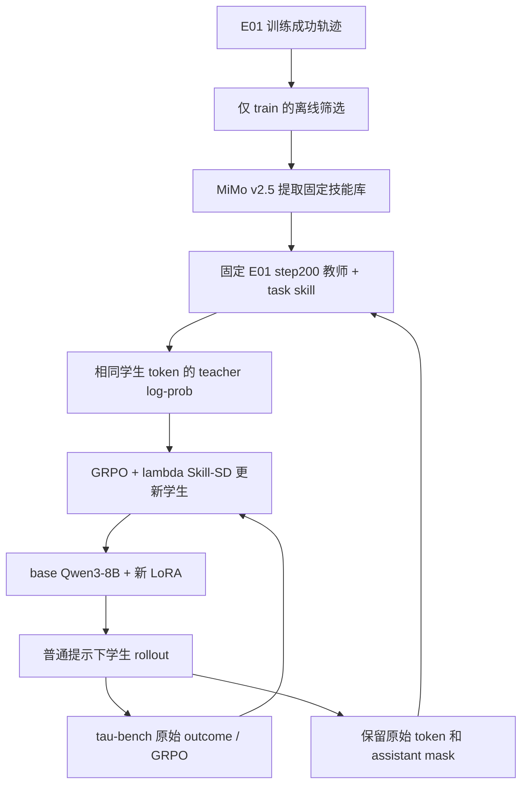

# GRPO + Skill-SD：固定 E01 教师的实验方案与 CPU 实现

更新：2026-10-11。方法配置：`qwen3_grpo_skill_sd`；产物目录：`experiments/grpo_skill_sd/`。

本轮范围：完成方案、代码、真实 E01 成功轨迹收集和 CPU 验证。**不提交 GPU 作业，不调用真实 MiMo 提取技能，不声称已完成训练或取得新成功率。** 200 步等参数是后续训练的默认方案，并非本轮启动授权。

## 1. 研究问题与论文关系

研究问题：在学生从 base Qwen3-8B 开始的前提下，E01 成功经验提炼出的技能，能否给已经训练好的 E01 教师带来额外的有效蒸馏信号，提高学生在留出任务上的成功率？

借鉴 [Skill-SD 论文 §3.2–3.3 与 Appendix D](https://arxiv.org/pdf/2604.10674)：学生用普通提示采样，教师用技能条件对相同 token 评分，辅助项采用重要性加权的 sampled-token 目标。原文采用动态自教师；本实验按用户设想改为固定 E01 教师和离线成功技能。因此这里是 **GRPO + 技能条件固定教师 OPD 变体**，不能作为原论文 OPSD 的完整复现。截至本轮调研，[作者项目页](https://skill-sd.github.io/) 的代码仍标为 Coming Soon；实现复用本仓库 veRL 和已有 OPD 扩展。

教师和学生虽然都是 8B，但参数不同。教师固定为 base + E01 step200 LoRA；学生初始化为 base + 新 LoRA。训练期间不把教师同步成学生，也不让学生加载 E01 adapter。

## 2. 数据来源与实际收集结果

唯一划分文件：`experiments/sft_collect_airline/split.json`，40 train / 10 test，不增加 dev。test ID 为 `[3, 10, 16, 20, 23, 26, 30, 36, 43, 46]`。

来源：`experiments/e01_vanilla_grpo/formal-seed42-200-v3/train/eval_trajectories.jsonl`。先核对该运行的 `summary.json` 已验收，再逐行筛选：

```text
validate == false AND split == "train" AND task_id 属于40个train任务 AND score == 1
```

成功判断直接使用已有二值 tau-bench outcome，不修改环境成功规则，不用 MiMo 判断成功。训练期间的独立 train 评测也排除，避免混入评测轨迹。检查任务划分 hash、轨迹 ID 唯一性、二值奖励，以及总数量与原汇总一致。

CPU 收集作业 **198226** 已完成（0 GPU，退出码 0）：

| 内容 | 实测数量 |
|---|---:|
| 原训练轨迹 | 6400 |
| 保存的成功训练轨迹 | 3551 |
| 排除的独立评测轨迹 | 640 |
| 有成功轨迹的 train 任务 | 37 / 40 |
| 无成功轨迹的 train 任务 | 2、8、9 |
| 选作 MiMo 输入的轨迹 | 146 |
| 预计技能提取请求 | 37，每个覆盖任务一次 |

保留全部 3551 条成功轨迹；提取输入对每个任务至多选 4 条，按 `(step, trajectory_id)` 排序后取等距位置，覆盖较早和较晚的成功记录。task44 仅有 2 条，全部使用。选择规则不看 test 分数，不额外偏向高频任务。

产物在 `experiments/grpo_skill_sd/corpus-e01-seed42-v1/`：

- `successful_train_trajectories.jsonl`：完整成功对话，仅保留必要字段。
- `extraction_inputs.jsonl`：37 组 MiMo 提取输入，共 146 条轨迹。
- `manifest.json`：原始文件、split、输入和输出 SHA256，逐任务数量及选择规则。

关键指纹：

| 对象 | SHA256 |
|---|---|
| split | `33f3c6399c81ed641e096dae438939b7121bba953f0dae7a5b86c640f66c3fb9` |
| E01 原始轨迹文件 | `7c4e81c23f6632b36a1392493a688ad5329e8fd87badf93b4f1ccaf2c5402b88` |
| 提取输入 | `b9656bcba3b050c96e371c2f81646fd239b9e56cd81277095772ecf62648c9d1` |

这 37/40 是潜在技能覆盖率；**真实技能尚未提取**。task2/8/9 在训练中仍正常抽样，使用不加技能的同一 E01 教师评分，GRPO 与蒸馏均保留。不能为了覆盖率虚构技能或从 test 补充成功案例。

## 3. 离线技能提取协议

入口：`scripts/train/grpo/extract_skill_bank.py extract`；复用 `src/envs/mimo_client.py`。

| 参数 | 设定 |
|---|---|
| 模型 | `mimo-v2.5` |
| 限流 | 100 RPM / 10,000,000 TPM，单个请求在途 |
| 采样 | 复用客户端 temperature 0.7、top_p 0.8、关闭 thinking |
| 输出 | 至多 1024 completion tokens；要求简短 JSON |
| 技能字段 | `success_analysis`、`mistake_analysis`、`golden_workflow` |
| 提示约束 | 三字段非空、共不超过约 160 英文词；泛化实例 ID、姓名和日期；不编造工具、政策或错误 |
| 真正硬限制 | 经 Qwen3 tokenizer 编码后的完整技能前缀不超过 512 tokens，超限报错 |

成功轨迹也可能包含可恢复错误；`mistake_analysis` 只能总结实际观察到的错误，没有时明确写无。API 结果满足 JSON/schema/token 限制不代表内容已经正确，需要在正式训练前审阅 37 条技能的政策一致性及是否残留具体答案。

每次请求保存模型、提示与输入 hash；通过校验的响应写入 `.responses.jsonl`，失败后可复用相同请求的缓存。技能库写入来源轨迹 ID、split hash、extractor model 和 prompt hash，并用文件 SHA256 固定版本。新实验不在线更新技能库。

凭据由现有 `setup/activate.sh` 加载 `~/.config/cabinagentrl/mimo.env`；任何文档、运行元数据和 Git 提交都不保存 API key。提取与后续用户模拟器共享同一额度，后续不得把同一 key 当作两份独占额度。

## 4. 完整训练流程



教师使用：

- base：`/projects/_hdd/cabinagentrlarchive/CabinAgent-RL/models/Qwen/Qwen3-8B`。
- base revision：`b968826d9c46dd6066d109eabc6255188de91218`。
- adapter：`/projects/_hdd/cabinagentrlarchive/CabinAgent-RL/checkpoints/e01_vanilla_grpo/formal-seed42-200-v3/global_step_200/actor/lora_adapter`。
- adapter 指纹：`8a80bd2f17167045dab44d3f899ccd82db91bb8b69be3ef7613fff294a4fe703`（按 `adapter_sha256` 的文件名 + 文件内容摘要组合规则计算）。
- PEFT 恢复 adapter，包括保存的 head；全部教师参数冻结。不生成合并模型，不需要已删除的 Qwen3-32B。

教师只评分学生实际采样的 token，不重新生成成功轨迹。去掉 padding 后，将独立编码的技能文本放在完整原始聊天 token 序列前，只平移 `response_start`。原始聊天模板、历史、工具返回、assistant token IDs 和 response mask 全部保持；学生 batch 不修改。这个前缀位置是一项明确的本地实现选择，GPU 前应验证教师确实利用了它。

技能只作用于当前任务的教师上下文。每次 HTTP 响应核对输入 hash、tokenizer 指纹、response_start、mask、policy_version、model/revision 和 adapter 身份。教师 adapter 在运行准备和服务启动时复算 hash；新方法另核对 base 的本地 Hugging Face commit 元数据与配置 revision，避免仅回显一个无关 revision。后者是来源核对，不是对全部大权重做内容 hash。

只有 assistant 的有效输出 token 参与两个损失；system/user/tool/padding 不参与。教师必须在本轮学生第一次更新前对整个 rollout batch 评分，分数固定到更新结束。验证和 test 不进入技能 scorer；缺少技能的 train 任务按普通教师评分并记录 fallback。

## 5. 目标函数与梯度

对轨迹 $i$ 的有效 assistant token $t$，定义当前学生 $p_\theta$、该轮采样策略 $p_{\mathrm{old}}$ 和固定技能教师 $q_\phi(\cdot\mid h,s_i)$：

$$
\ell_{it}=\log p_\theta(a_{it}\mid h_{it})-\operatorname{sg}\!\left[\log q_\phi(a_{it}\mid h_{it},s_i)\right]
$$

$$
\rho_{it}=\exp\left(\log p_\theta(a_{it}\mid h_{it})-\operatorname{sg}\!\left[\log p_{\mathrm{old}}(a_{it}\mid h_{it})\right]\right),\qquad k_{3,it}=\exp(-\ell_{it})-1+\ell_{it}
$$

$$
L_{\mathrm{Skill\text{-}SD}}=\frac{1}{B}\sum_{i=1}^{B}\frac{1}{T_i}\sum_{t\in\mathcal A_i}\rho_{it}k_{3,it},\qquad L=L_{\mathrm{GRPO}}+0.001L_{\mathrm{Skill\text{-}SD}}.
$$

这里 $T_i=|\mathcal A_i|$。**保持 E01 的 `seq-mean-token-mean`：轨迹内 token 平均，再按轨迹平均**；不是全 batch token 平均。这使 GRPO 和辅助损失的轨迹权重一致，也明确区别于采用全局 token mean 的论文实现形式。

`sg` 表示停止梯度；teacher 和 old 固定，**rho 不 detach**。忽略归一化时，单 token 对当前 log-prob 的导数为 $\rho\ell$。只反传 $k_3$ 或把 rho detach 都改变目标梯度。新分支因此使用单独的 `loss_type: skill_sd`，不直接沿用 E06 的 clipped sampled-token policy-gradient 损失。

FP32 中计算 `expm1(-ell)+ell`，先清除 mask 外数值再做指数运算；非有限有效值报错，不靠静默 clipping 改变辅助目标。GRPO 保持原来的 PPO 裁剪，辅助项不做 PPO 裁剪。lambda=0 跳过教师评分并恢复纯 GRPO 更新路径。

lambda=0.001 是未调优起点，不表示已经达到两种信号的最佳平衡。是否过强/过弱要结合系数加权的 log-prob 梯度、训练诊断和成本判断，不能仅凭两个 loss 的原始绝对值。

## 6. 复用的默认训练和评估配置

| 项目 | 默认值 |
|---|---|
| 学生 | base Qwen3-8B，新的 LoRA，rank16 / alpha32，all-linear，seed42 |
| 学习率 | 5e-6，constant；不添加 entropy 或 reference KL |
| 训练 | 200 步；每步 4 tasks × 8 rollouts = 32 条；ppo_epochs=1 |
| 采样 | temperature1 / top_p1 / top_k=-1，enable_thinking=false |
| 长度 | prompt8192 + response12288；每类对话轮数上限15 |
| 学生计算 | 去 padding、动态微批、32768 token/GPU、FlashAttention2、bf16、梯度 checkpoint |
| 教师长度 | 24576；最多 512 skill tokens 加在真实输入前 |
| 保存 | 50/100/150/200 步完整 checkpoint，SSD 写出后按现有流程归档 HDD |
| 训练诊断评测 | 100/200 步，40 train × 8，无技能、无教师 |
| 最终 test | 预定 step200，10 test × 8；不根据 test 挑 checkpoint 或 lambda |
| 评估采样 | temperature0.7 / top_p0.9 / top_k=-1 |

后续 GPU 拓扑复用同节点 2×Pro6000、同一个 srun step：rank0 学生训练/rollout，rank1 固定教师；MiMo 提供外部用户模拟器。**该联合链路尚未进行 GPU 显存、加载、checkpoint 或步时验证**；E01 的单学生显存测试不能证明新增教师链路已通过。学生基础模型与 teacher adapter 在 HDD 做已批准的顺序读取，活跃数据/日志/环境放 SSD。

沿用本项目 tau-bench 原始成功判定与 `src/evaluation/pass_metrics.py`。主指标是任务宏平均 $\mathrm{pass}^{1}$；辅助报告 $\mathrm{pass}^{4}$ 与 $\mathrm{pass@4}$，区分连续四次全部成功和四次至少一次成功。对于每任务 $n=8$ 次中 $c$ 次成功：

$$
\mathrm{pass}^{1}=\frac{1}{M}\sum_j\frac{c_j}{8},\quad
\mathrm{pass}^{4}=\frac{1}{M}\sum_j\frac{\binom{c_j}{4}}{\binom{8}{4}},\quad
\mathrm{pass@4}=\frac{1}{M}\sum_j\left(1-\frac{\binom{8-c_j}{4}}{\binom{8}{4}}\right).
$$

train/test 分开；保留逐任务结果、工具错误、轮数耗尽、assistant tokens、API 与 GPU 成本。不把 80 条 test 重复当成 80 个独立任务。项目历史已评测这 10 个 test，不能宣称它们在整个研究历史上从未曝光。

## 7. 最小对照与风险

| 分支 | 教师 | 技能 | 意义 |
|---|---|---|---|
| 既有 E01 | 无 | 无 | 纯 GRPO 基线 |
| 新方法无技能消融 | 固定 E01 step200 | 关闭 | 分离“更好的教师”与“技能”的贡献 |
| 新方法主实验 | 同一固定 E01 step200 | 训练任务离线技能 | 检验额外技能信息 |

无技能消融复用同一配置并传 `distillation.use_skills=false`，其余损失/预算保持一致；不是拿旧的 32B E07 直接替代这个对照。本轮只实现开关和 CPU 验证，不自动启动这些训练。

需在后续训练中检验：固定教师可能限制学生上限；成功样本偏向易任务且缺少失败原因；同任务技能可能压制有效替代操作；前缀不保证提升教师质量。提取输入覆盖任务只有 37 个，应单独报告这 37 个与 fallback 的 3 个任务，但主结果仍使用全部 40 train 和全部 10 test。

既有 E01 checkpoint 和轨迹已经消耗 200 步训练预算。新学生的 200 步是**增量成本**，总方法成本还应计入教师预训练、技能 API 与教师评分，不能把复用工件描述成零成本或直接声称比单次 GRPO 更省样本。

## 8. 实现位置、指标与验证入口

| 能力 | 共用/新增位置 |
|---|---|
| 配置 | `configs/train/grpo/qwen3_grpo_skill_sd.yaml` |
| 数据收集/技能库 | `src/training/skill_bank.py`、`scripts/train/grpo/extract_skill_bank.py` |
| 教师 token 对齐与技能注入 | `src/training/distillation.py` |
| 固定 LoRA 教师/身份 | `src/models/token_teacher.py`、`scripts/train/grpo/serve_token_teacher.py` |
| loss / actor 分支 | `verl/verl/trainer/ppo/distillation_loss.py`、`verl/verl/workers/actor/dp_actor.py`（仓库根路径） |
| 共用训练 | `run_qwen3_teacher_pair.sh` → `run_qwen3_formal.sh` → `run_qwen3.sh`，均在 `scripts/train/grpo/` |
| 数据准备/元信息 | `scripts/train/grpo/prepare_qwen3_run.py`，记录配置覆盖、技能覆盖、teacher 身份 |
| 汇总 | `scripts/eval/summarize_qwen3.py`，识别新的 Skill-SD 指标 |
| Slurm | 根目录 `cluster_setup/qwen3_shared/check.sbatch` / `teacher_pair.sbatch` |

核心新增曲线：`actor/skill_sd_loss`、`skill_sd_ell_mean`、`skill_sd_rho_mean`、`skill_sd_k3_mean`、`skill_sd_signal_token_fraction`、`skill_sd_logprob_grad_norm`，以及 `actor/rl_loss`、`rl_logprob_grad_norm`、`actor/grad_norm`。覆盖记录为 `distillation/skill_coverage`、`skill_tokens`、`skill_fallback_trajectories`。

新 loss 在一个 minibatch 内正确累加微批贡献，避免把已除过梯度累积次数的 loss 再平均一次。这里单 actor GPU、32 条组成一个 minibatch、单 PPO epoch，指标可以按这一训练步解释；若后续扩展到多个 minibatch/worker，框架会再等权聚合，各 token 统计不能冒称全局 token 加权均值。两个 `logprob_grad_norm` 是系数和微批权重后的 **log-prob 梯度范数**，不是模型参数梯度或两个梯度的夹角。

CPU 验证复用 `check_distillation.sh`，包括原 GRPO/PRM/LATA/OPD/OPSD 回归、新损失解析梯度、旧采样分母固定、mask、静态/动态微批一致性、lambda=0、tiny CPU Qwen3+PEFT 恢复 head、mock HTTP 身份/对齐、技能提取缓存与数据隔离、真实 tokenizer/config/adapter 指纹。

### CPU 执行方式

以下从仓库根目录运行；先将代码冻结为新快照，运行中的快照不改动。CPU `check.sbatch` 使用 `cpu_ok`，不申请 GPU。

```bash
python3 agentic-grpo-longhorizon/scripts/train/grpo/snapshot_qwen3_source.py \
  agentic-grpo-longhorizon/experiments/grpo_skill_sd/source-cpu-v1

export SOURCE_ROOT="$PWD/agentic-grpo-longhorizon/experiments/grpo_skill_sd/source-cpu-v1"
export RUN_ROOT="$PWD/agentic-grpo-longhorizon/experiments/grpo_skill_sd/cpu-validation-v1"
export TASK_ENTRY=scripts/train/grpo/check_distillation.sh
export DISTILLATION_CONFIGS=qwen3_opd,qwen3_grpo_opd,qwen3_opsd,qwen3_grpo_opsd,qwen3_grpo_skill_sd
export TEACHER_MODEL=/projects/_hdd/cabinagentrlarchive/CabinAgent-RL/models/Qwen/Qwen3-8B
mkdir -p "$RUN_ROOT"
sbatch --output="$RUN_ROOT/slurm-%j.out" --error="$RUN_ROOT/slurm-%j.err" \
  cluster_setup/qwen3_shared/check.sbatch
```

上述脚本创建 `mock-skills-DO-NOT-TRAIN.json`，仅测试配置和元信息；它不是 MiMo 生成的真实技能，不可用来正式训练。此次旧 OPD 配置检查使用现存 8B tokenizer，不表示重新验证了已经删除的 32B 权重。

### 后续真实技能提取与 GPU 阶段（本轮未执行）

真实提取仍用 CPU Slurm：设置 `TASK_INTERPRETER=python`、`TASK_ENTRY=scripts/train/grpo/extract_skill_bank.py`，向共用 `check.sbatch` 传 `extract --manifest <corpus/manifest.json> --output <new-bank.json> --tokenizer <base8B>`。开始前换用新的 RUN_ROOT、冻结源、核对额度；凭据由激活脚本注入。成功后审阅技能并保存文件 SHA256。

后续 GPU 使用 `QWEN3_CONFIG=qwen3_grpo_skill_sd`，并显式提供 `TEACHER_ADAPTER_SHA256`、`SKILL_BANK_PATH`、`SKILL_BANK_SHA256`、`CHECKPOINT_ARCHIVE_ROOT`，复用 `teacher_pair.sbatch`。训练配置覆盖会同步记录进 run.json。先完成另行授权的短 GPU 验证，包括同权重评分对齐、首步显存/梯度/耗时、保存/恢复，再决定正式提交。此处不提供会被误认为已经执行的作业号。

## 9. 本轮验收记录

真实收集：198226 完成，数据数量见第 2 节。初次作业 198219 因历史 E01 元信息未显式含 `reward_mode` 而拒绝；已按共用汇总器的 legacy binary 规则修正并补充用例，原日志和快照保留。

统一 CPU 作业 **198233** 已完成：`COMPLETED / 0:0`，耗时 **1 分 49 秒**，申请 **0 GPU**。共 **208 项测试通过**：共用回归 97 项，teacher / distillation / skills / loss 回归 111 项；此外五组 Hydra 配置、真实 8B tokenizer、实际 E01 adapter 指纹、本地 base revision、输入元信息及消融覆盖均通过。

证据：`experiments/grpo_skill_sd/cpu-validation-v1/slurm-198233.out`、`distillation-tests.xml`、`skill-cpu-identities.json` 和各配置的 `*-input/run.json`；不可变源码在 `source-cpu-v1/`，汇总在 `experiments/grpo_skill_sd/cpu_validation.json`。修改的 Python 文件 Ruff check 通过，veRL 四个文件的 Ruff format --check 通过；修改的 shell 语法检查通过，本文数学定界符已核对。

主线程完成方案、数据路径、公共入口集成和验收；explorer 调查并复核代码/数据/论文，两个实现子线程分别完成 loss 和 teacher。项目 worker 配置中的 `gpt-6.1-Sol` 标识启动失败，实际实现改用可用标识 `gpt-6.1-sol` 承担 worker 职责，未修改项目模型配置。

本轮交付完成。后续正式实验仍需真实技能 API 提取/内容审阅和 GPU 验证训练，均不计作本轮已完成成果。
